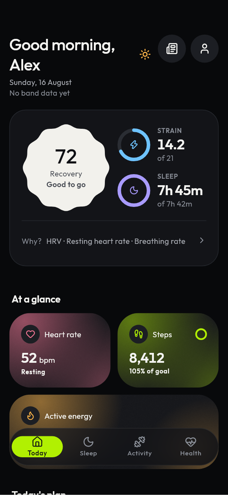
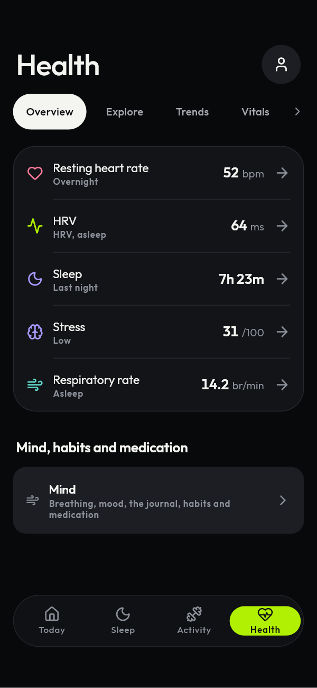
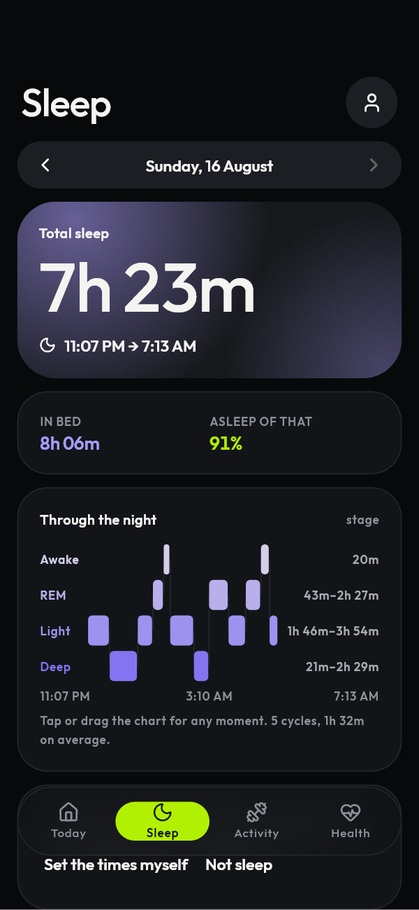
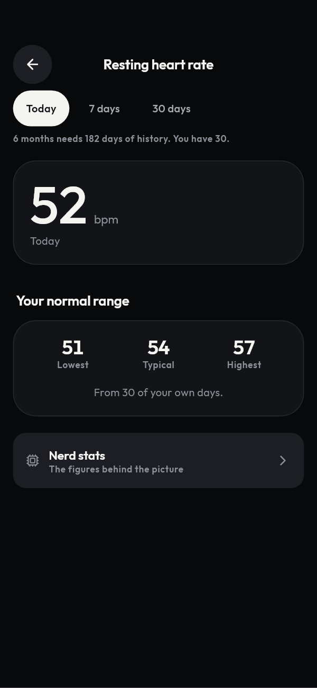
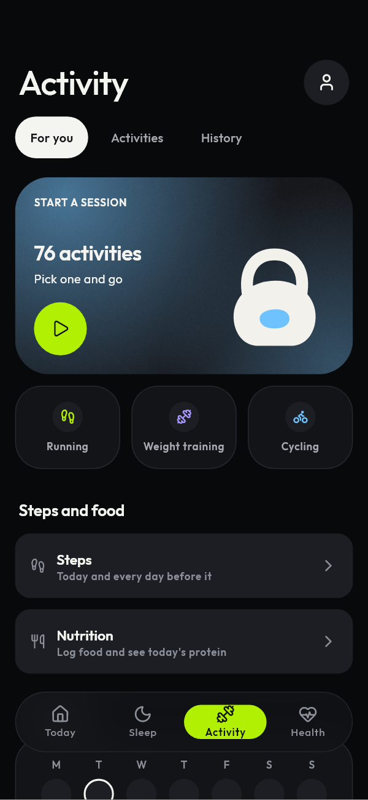

> [!WARNING]
> **WHOOP users: do not reconnect to the official WHOOP app.**
>
> If you use OpenStrap or another open-source app, or plan to switch to one later,
> do not connect your band to the WHOOP app again. It can install firmware updates
> automatically.
> Uninstall or disable the WHOOP app to prevent it from updating your band.
>
> Users report blocked data access on WHOOP 5.0 / MG firmware **50.43.1.0** and
> **50.43.2.0**. Bluetooth may still connect while history or live data is withheld.
> OpenStrap cannot issue the WHOOP-signed membership token needed to unlock an
> affected band. See [firmware compatibility](#whoop-firmware-compatibility)
> for the evidence and its limits.


A health app for your wearables. No subscription, no fees, private by default.

<a href="https://trendshift.io/repositories/51733?utm_source=repository-badge&amp;utm_medium=badge&amp;utm_campaign=badge-repository-51733" target="_blank" rel="noopener noreferrer"></a>

[](https://github.com/OpenStrap/edge/releases/latest)
[](https://testflight.apple.com/join/2BVSwq65)

As featured in [Hackaday](https://hackaday.com/2026/07/15/making-a-locked-down-wearable-work-without-a-subscription/) and [Adafruit](https://blog.adafruit.com/2026/07/15/openstrap-edge-makes-a-whoop-4-0-band-useful-without-a-subscription/).

|  |  |  |  |  |
|:--:|:--:|:--:|:--:|:--:|
| Today | Health | Sleep | Heart rate | Workout |

## Devices

**Supported:** WHOOP 4.0, 5.0, MG, subject to the [firmware restrictions below](#whoop-firmware-compatibility).

**Being built:** Oura Ring, Garmin, Pebble, Colmi, Ultrahuman, Mi Band and more.

Full feature list: [docs/FEATURES.md](docs/FEATURES.md).

## WHOOP firmware compatibility

Research checked on **November 9, 2026**. These are community observations, not a
complete list of affected firmware versions.

| Device / firmware | Evidence |
|---|---|
| WHOOP 5.0, **50.43.1.0** | A [November 7 OpenStrap report](https://github.com/OpenStrap/edge/issues/673) describes successful Bluetooth connections and command replies, but no history or live HR. Data resumed after the official app installed a WHOOP-signed membership token. |
| WHOOP 5.0 / MG, **50.43.2.0** | A [November 3 NOOP report](https://github.com/ryanbr/noop/issues/2890#issuecomment-6614654919) describes history stopping after the update while live HR and beat timing still worked. This is a reported sync failure; its token-related cause has not been established. |
| WHOOP MG, **50.42.1.0** | A [November 1 report](https://github.com/ryanbr/noop/issues/2890) records certificate commands and a 45-day certificate counter. It does not establish when enforcement began. |
| WHOOP 4.0 | These reports do not establish that the same signed-token restriction affects 4.0. Avoid reconnecting it to the official app too if you want to preserve open-source compatibility. |

The 50.43.1.0 report describes a device-bound token signed by WHOOP using ES256,
a public/private-key signature scheme. The band checks WHOOP's signature;
creating your own key pair cannot produce a token it will accept. The reported
failure occurs after Bluetooth connects, when the band withholds sensor data.
The reporter's token lasted about 45 days, but what happens at expiry or when
membership ends remains unverified. OpenStrap cannot mint or renew these tokens.

**Release timing:** [users reported receiving 50.43.1.0 on October 19,
2026](https://www.reddit.com/r/whoop/comments/1xa1r58/firmware_update_available_504310/).
[WHOOP's release-notes page](https://support.whoop.com/s/article/WHOOP-5-0-MG-Firmware-Release-Notes?language=en_US)
is dated October 26, 2026 and lists 50.43.2.0 as current. WHOOP says updates are
automatic and phased, but provides no release date for each version or mention
of this restriction. **The exact rollout start and first enforcing version are
unknown.** October 19 establishes that 50.43.1.0 was available by then; October 26
is the page date, not a confirmed firmware release date.

If your band has already updated, the version alone does not prove it is locked.
If you plan to switch to OpenStrap later, keep your band off the official WHOOP
app in the meantime. We are working on a solution, but no fix is available yet.
These reports do not establish a reliable downgrade.

## Support

OpenStrap has no company, no subscription and no paywall behind it. If it's useful to
you, a tip helps keep it going.

**Bitcoin**

```
bc1qvtcch38dcwp967ar764uu6eetw7tf907844wfq
```

**EVM** (Ethereum, Base, Arbitrum, Optimism, Polygon)

```
0x8310C89393366b7eBCD47ABa82e1dfB5ECeFFbD9
```

## Community

[Discord](https://discord.gg/dUXds5MWkd) · [Reddit](https://www.reddit.com/r/OpenStrap/)

## Guides

- [Development: build and run from source](docs/DEVELOPMENT.md)
- [Features](docs/FEATURES.md)
- [iOS installation](guides/IOS_INSTALLATION.md)
- [iOS sideload](guides/IOS_SIDELOAD.md)
- [iOS Shortcuts](guides/IOS_SHORTCUTS.md)
- [Apple Watch setup](guides/WATCH_SETUP.md)
- [AI coach](guides/AI_COACH.md)
- [Tasker integration](guides/TASKER_INTEGRATION.md)
- [Buzz meanings](guides/BUZZ_MEANINGS.md)
- [Writing a device adapter](docs/ADAPTERS.md)

## Contributing

Bug reports from real devices are the most useful thing you can send. PRs are welcome;
read [CONTRIBUTING.md](CONTRIBUTING.md) first, which covers which repo a change belongs
in. Security issues go through
[SECURITY.md](SECURITY.md).

## Privacy

Everything stays on your phone unless you opt in. Details in [PRIVACY.md](PRIVACY.md).

## Disclaimer

OpenStrap is independent and not affiliated with or endorsed by WHOOP, Oura, Garmin or
any device maker. Product names are trademarks of their owners and are used only to
describe compatibility.

## License

AGPL-3.0. See [LICENSE](LICENSE). The OpenStrap name and logo: [TRADEMARKS.md](TRADEMARKS.md).
