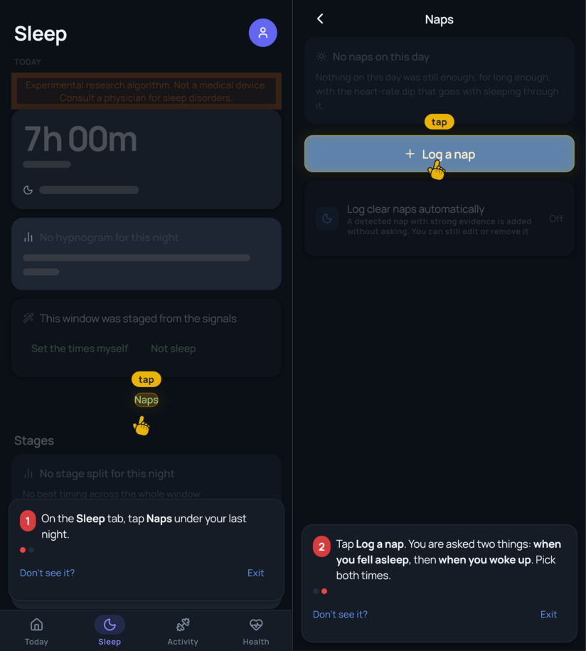
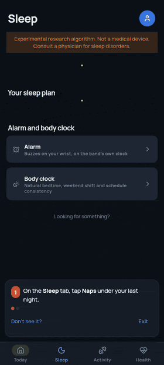

# Where to log a nap yourself

I took a nap and the band missed it. How do I add it?

Start it from **Profile** > **Help**, under **Sleep**. See [Live guides](Guides.md) for how guides work.

## Steps

1. On the **Sleep** tab, tap **Naps** under your last night.
2. Tap **Log a nap**. You are asked two things, **when you fell asleep**, then **when you woke up**. Pick both times.

The two time questions are pop-ups, so the guide steps aside while you answer them.

## On the last card

When you finish, the Done card adds:

- **Naps the band found.** Naps the band detected are listed on the same screen. If one is wrong, tap **Not a nap** next to it.
- **The nap won't save?** A nap lasts between 5 minutes and 3 hours, has to be over already, and can't overlap another nap or your main sleep.

## Screenshots

One picture per step, side by side.

The whole guide in motion, ending on the Done card.

[Back to the wiki home](Home.md)
