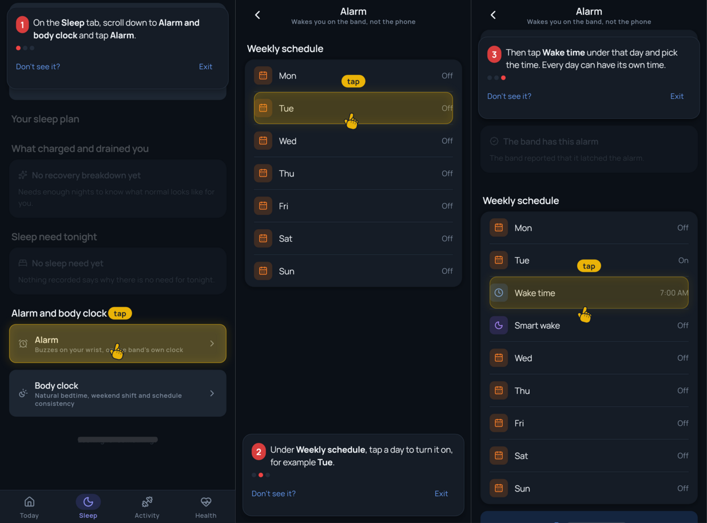
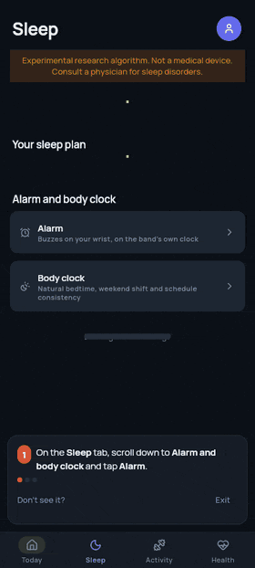

# Where to set an alarm, or a different time each day

How do I set the alarm, and can each day have its own wake time?

Start it from **Profile** > **Help**, under **Sleep**. See [Live guides](Guides.md) for how guides work.

## Steps

1. On the **Sleep** tab, scroll down to **Alarm and body clock** and tap **Alarm**.
2. Under **Weekly schedule**, tap a day to turn it on, for example **Tue**. Any of the seven days works.
3. Then tap **Wake time** under that day and pick the time. Every day can have its own time.

Step 3 appears once a day is turned on. Until then the guide stays on step 2.

## Don't see it?

The guide's **Don't see it?** link opens this note, titled "Don't see "Weekly schedule"?".

> **Weekly schedule** only shows while your band is connected. Keep the band close to your phone, wait for it to connect, then look again.

## On the last card

When you finish, the Done card adds:

- **Another way in.** Open **Profile**, then **Settings**, then **The band**, then **Alarm**.

## Screenshots

One picture per step, side by side.

The whole guide in motion, ending on the Done card.

[Back to the wiki home](Home.md)
