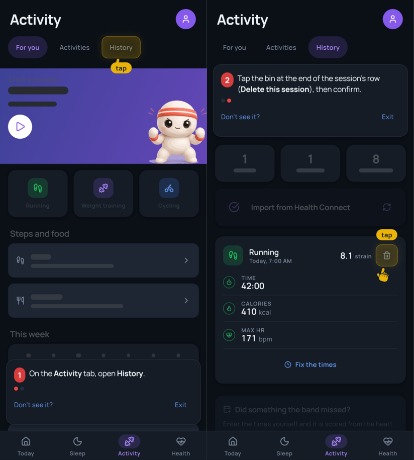
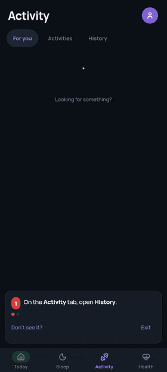

# Where to delete a workout

How do I delete a workout I recorded?

Start it from **Profile** > **Help**, under **Activity**. See [Live guides](Guides.md) for how guides work.

## Steps

1. On the **Activity** tab, open **History**.
2. Tap the bin at the end of the session's row (**Delete this session**), then confirm. Each session has its own bin, and the guide outlines the top one.

The confirm box is a pop-up, so the guide steps aside while you answer it.

## Don't see it?

The guide's **Don't see it?** link opens this note, titled "No bin to tap?".

> If History says **No sessions recorded yet**, there is nothing to delete yet. **Start a workout** or **Log a past workout** adds a session.

## On the last card

When you finish, the Done card adds:

- **What deleting does.** The session disappears from the app. A copy in your phone's health app, if there is one, stays where it is.

## Screenshots

One picture per step, side by side.

The whole guide in motion, ending on the Done card.

[Back to the wiki home](Home.md)
