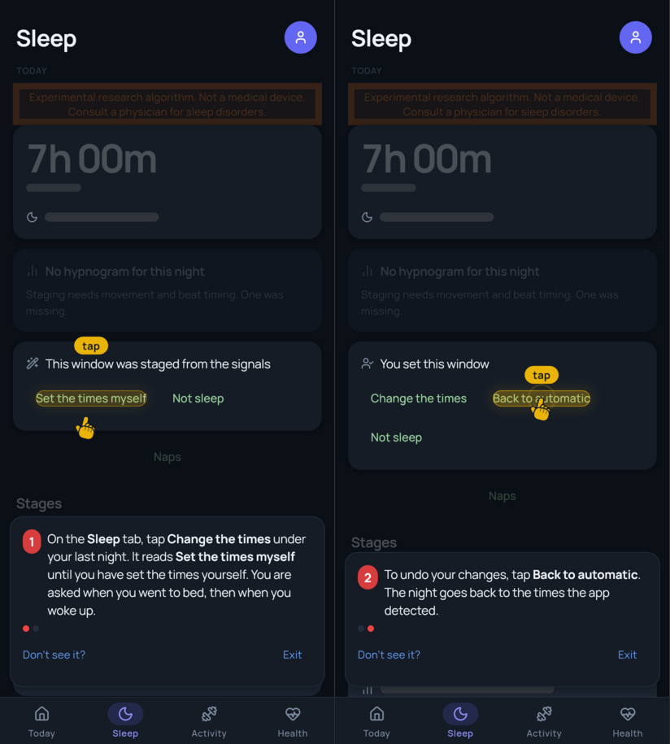
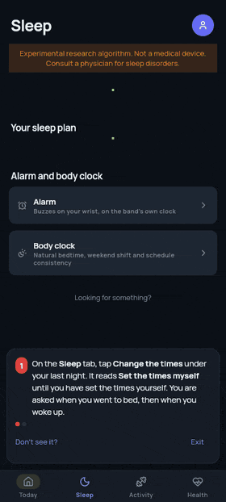

# Where to fix your sleep times

Last night's bed time or wake time is wrong. How do I correct it?

Start it from **Profile** > **Help**, under **Sleep**. See [Live guides](Guides.md) for how guides work.

## Steps

1. On the **Sleep** tab, tap **Change the times** under your last night. It reads **Set the times myself** until you have set the times yourself. You are asked when you went to bed, then when you woke up.
2. To undo your changes, tap **Back to automatic**. The night goes back to the times the app detected.

Step 2 appears after you tap the times control in this guide, while the times are your own and the whole night's recordings are still stored. Without those recordings, **Back to automatic** is not shown. The two time questions are pop-ups, so the guide steps aside while you answer them.

## Don't see it?

The guide's **Don't see it?** link opens this note, titled "Don't see "Back to automatic"?".

> **Back to automatic** only shows after you set or confirm the times yourself, while the whole night's recordings are still stored.

## On the last card

When you finish, the Done card adds:

- **What the pickers ask.** First the time you went to bed, then the time you woke up. The night is worked out again from those two times.

## Screenshots

One picture per step, side by side.

The whole guide in motion, ending on the Done card.

[Back to the wiki home](Home.md)
