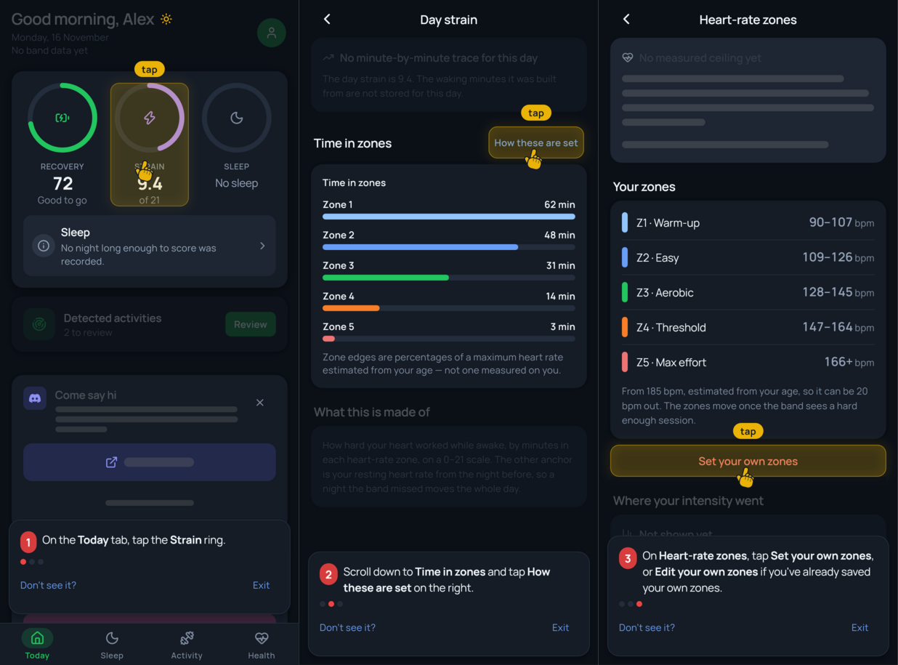
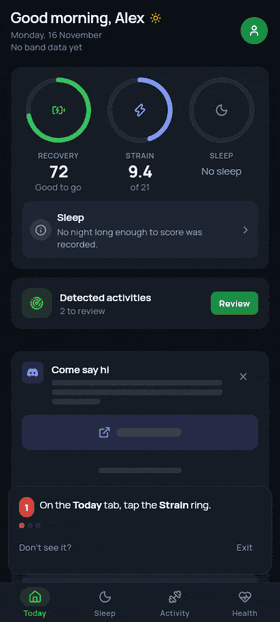

# Where to find your heart-rate zones

Where do I see or change my heart-rate zones?

The zones screen sits behind your Strain score. It takes three taps.

Start it from **Profile** > **Help**, under **Today**. See [Live guides](Guides.md) for how guides work.

## Steps

1. On the **Today** tab, tap the **Strain** ring.
2. Scroll down to **Time in zones** and tap **How these are set** on the right.
3. This is the **Heart-rate zones** screen. To enter your own, tap **Set your own zones**. Once you have saved your own, the link reads **Edit your own zones**.

## Don't see it?

The guide's **Don't see it?** link opens this note, titled "Don't see "Time in zones"?".

> It appears once the band has recorded heart rate for the day and your zones can be worked out. If it still doesn't show after you've worn the band for a while, add your age in your profile.

## On the last card

When you finish, the Done card adds:

- **Another way in.** Open the **Activity** tab and tap **Today's strain**, then follow steps 2 and 3.

## Screenshots

One picture per step, side by side.

The whole guide in motion, ending on the Done card.

[Back to the wiki home](Home.md)
