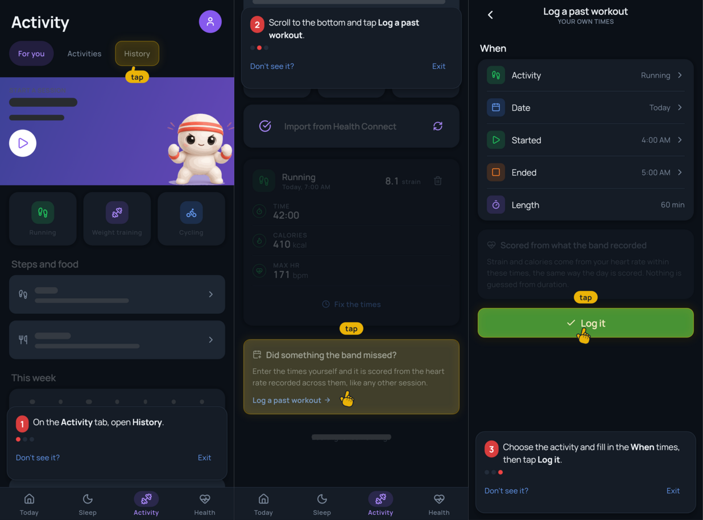
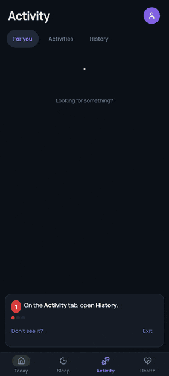

# Where to log a workout you forgot to record

I did a workout and did not record it. How do I add it afterwards?

Start it from **Profile** > **Help**, under **Activity**. See [Live guides](Guides.md) for how guides work.

## Steps

1. On the **Activity** tab, open **History**.
2. Scroll to the bottom and tap **Log a past workout**.
3. Choose the activity and fill in the **When** times, then tap **Log it**.

## Don't see it?

The guide's **Don't see it?** link opens this note, titled "Don't see "Log a past workout"?".

> It sits at the very bottom of **History**, below your sessions. Scroll all the way down.

## On the last card

When you finish, the Done card adds:

- **Will it get a score?** If the band recorded your heart rate for that time, the workout is scored from it. If not, it is saved without a score.

## Screenshots

One picture per step, side by side.

The whole guide in motion, ending on the Done card.

[Back to the wiki home](Home.md)
