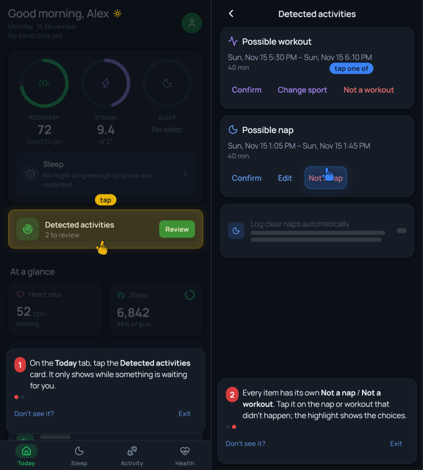
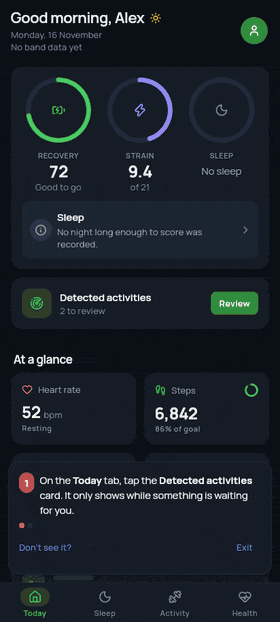

# Where to remove a nap or workout that wasn't real

The band found a nap or workout that never happened. How do I get rid of it?

Start it from **Profile** > **Help**, under **Today**. See [Live guides](Guides.md) for how guides work.

## Steps

1. On the **Today** tab, tap the **Detected activities** card. It only shows while something is waiting for you.
2. Tap **Not a nap** on a nap, or **Not a workout** on a workout, that didn't happen. Every item in the list has its own button, and all of them work.

## Don't see it?

The guide's **Don't see it?** link opens this note, titled "Don't see "Detected activities"?".

> The card is only there while something is waiting for your answer. Once it has been answered, look under **Sleep** > **Naps** for naps, or **Activity** > **History** for workouts.

## On the last card

When you finish, the Done card adds:

- **Already saved?** Open the **Sleep** tab and tap **Naps**. Tap **Not a nap** on a nap the band found, or **Delete** on one you logged yourself.

## Screenshots

One picture per step, side by side.

The whole guide in motion, ending on the Done card.

[Back to the wiki home](Home.md)
