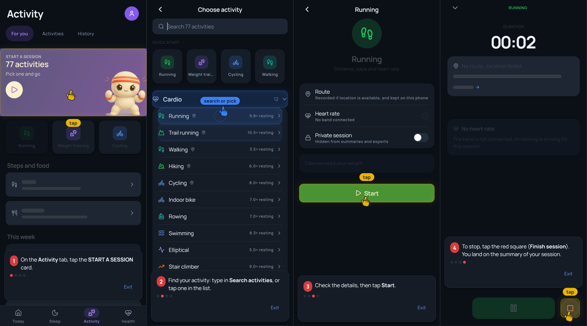
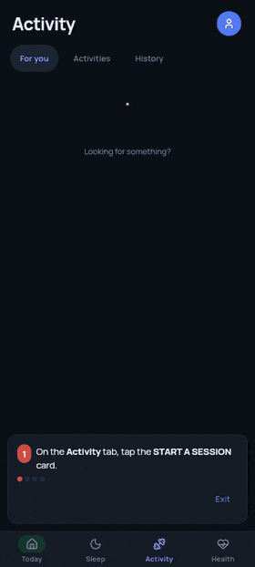

# Where to start and stop a workout

How do I record a workout from the app?

Start it from **Profile** > **Help**, under **Activity**. See [Live guides](Guides.md) for how guides work.

## Steps

1. On the **Activity** tab, tap the **START A SESSION** card.
2. Find your activity. The guide opens the first activity group once, unless you have already opened a group. Type in **Search activities**, tap a recent activity, or pick a row.
3. Check the details, then tap **Start**. The guide keeps **Route**, **Heart rate** and **Private session** readable so you can check them.
4. To stop, tap the red square (**Finish session**). You land on the summary of your session.

## On the last card

The guide shows these two notes on its last card, which appears after you stop. Read them first if you need them:

- **No band connected?** You can still start a session. A disconnected band supplies no heart rate, but another connected heart-rate sensor can.
- **Need a break?** Tap **Pause** to stop the clock, and **Resume** to carry on.

## Screenshots

One picture per step, side by side.

The whole guide in motion, ending on the Done card.

[Back to the wiki home](Home.md)
